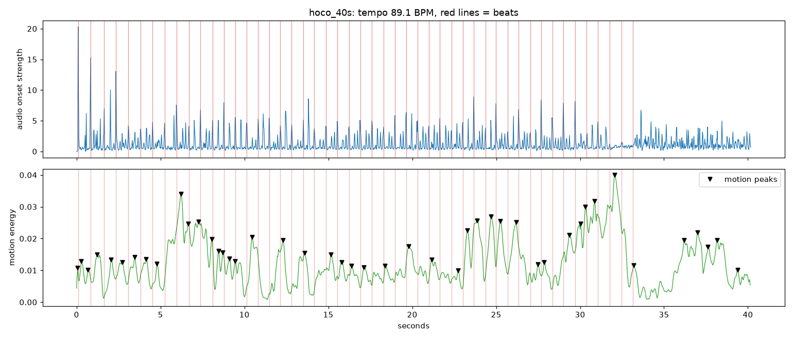

# Drum / motion sync: research prototype (session 24)

Question: can we measure how well the performers' movement lines up with the drum, as a signal for performer feedback?
Not wired into the app. Script: `backend/scripts/beat_sync.py`, tests: `backend/tests/test_beat_sync.py`
(synthetic click track with motion bumps at known offsets; the offsets are recovered). librosa and matplotlib are in
`requirements-dev.txt` only.

## Method

1. Audio: the export ffmpeg binary (`services.export.resolve_ffmpeg`) writes mono 22.05 kHz wav.
2. librosa: onset strength envelope, `beat_track` (beats) and `onset_detect` (drum-like onsets).
3. Motion: the app's own `compute_crop_box`, then one sequential pass over every frame. Crop to the box, downscale to
   320 px wide, blur, frame difference against the previous frame. Energy per frame = fraction of lit pixels
   (gray > 50) whose change exceeds 20 levels.
4. Motion peaks: energy smoothed over 0.1 s, `scipy.signal.find_peaks` with at least 0.2 s between peaks and
   prominence of 0.5 standard deviations.
5. Offset = peak time minus nearest beat (positive: motion after the beat). Beat statistics only use peaks inside the
   span the beat tracker covers. Onset statistics are reported as well.
6. Chance baseline (added after the first run showed why it is needed): slide the whole peak train by a random circular
   shift 1000 times and see how often a peak lands within 100 ms of a beat or onset anyway.

## Result on hoco_40s.mp4 (40.2 s, 30 fps)

Raw data: `hoco_40s.beat_sync.json`. Crop box (0.11, 0.29)-(0.89, 0.93). Tempo 89.1 BPM, 49 beats (the tracker stops at
33 s), 132 onsets, 46 motion peaks.

| Reference | Peaks used | Mean offset | Median offset | Within 100 ms | Chance (mean / 95th pct) |
|---|---|---|---|---|---|
| Beats | 41 | +0.041 s | +0.086 s | 19.5% | 24.3% / 41.5% |
| Drum onsets | 46 | -0.019 s | -0.018 s | 60.9% | 60.1% / 71.7% |

Without the span restriction the beat numbers look worse (mean offset +0.53 s, 17% within) only because five late peaks
have no beat near them; that is a tracker artifact, not a sync result.

**Reading:** the clip shows no measurable sync signal. Both scores sit at chance. The near-zero onset offsets are an
artifact of density: onsets are about 0.3 s apart, so any peak is within 0.15 s of one. The beat offsets are spread
roughly evenly over the whole +-0.35 s beat interval (motion peaks come about every 0.70 s, the beat period is 0.67 s,
so the two trains drift through each other) with no cluster at any phase.

## Is the signal usable for performer feedback?

Not as built, and this clip cannot show whether it could be. A fair statement is "inconclusive, leaning not usable
without more work":

- The metric is only meaningful against a chance baseline, and here it does not beat one.
- With a dense onset list, "percent within 100 ms" is nearly uninformative. It needs sparse, strong hits (the bass
  drum) or a tempo-grid-based measure.
- Sample size is one clip and about 45 peaks, so it would take roughly a dozen clips, ideally some with a known-tight
  and a known-loose performance, to calibrate anything. Showing a team a "sync score" from this would be inventing
  precision.

## Honest limits

- **Camera motion:** hand-held phone clips pan and shake. Frame differencing counts it as motion everywhere, and the
  crop box (78% x 63% of the frame here) is too large to exclude audience and background movement. No camera-motion
  compensation was attempted.
- **Several lions at once:** one summed energy value per frame. Lions that hit on different beats, or an
  off-beat step pattern, blur into one noisy curve. There is no per-lion tracking.
- **Music without clear drum hits:** lion dance is mostly drum, gong and cymbal, with crowd noise and, in this clip,
  other music. The onset envelope is busy throughout, and the beat tracker lost the pulse after 33 s. Tempo
  estimates can also lock to half or double time.
- **What the motion peak means:** a peak is the largest frame-to-frame change, which can be a head toss, a jump or
  the landing. Which of these should land on the beat is not defined, so a constant offset (for example landings 80 ms
  after the hit) would be real but is indistinguishable from lag.
- **Timing precision:** 30 fps gives 33 ms steps; audio/video sync in phone recordings can itself be off by tens of
  milliseconds.
- **Not tested:** other clips, other crop settings or thresholds, and a hand-labelled ground truth.

## Suggested next steps if this is pursued

Per-lion or per-region motion (grid cells) to cut camera and background noise; stabilize the camera first; use the low-
frequency drum band for onsets so the reference is sparse; measure phase concentration (a circular statistic) instead of
a fixed window; calibrate on several clips with a known tight and loose performance.
